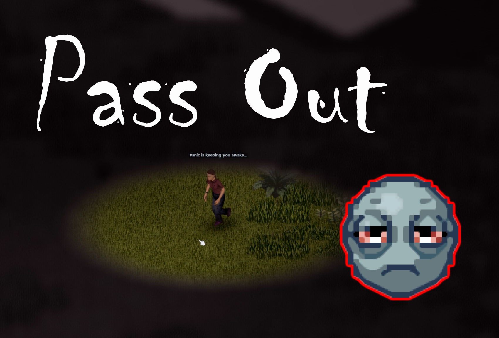

# Pass out

Causes your character to fall asleep on the spot if you have max tiredness for X in-game hours (default 6). The amount of hours, whether a warning is given, and collapse behavior are configurable in the sandbox options.

This is intended for a more hardcore playthrough.

Dual-build compatible with **Build 42** (primary) and **Build 41** (backport).

---

### Features:

- **Build 42 & Build 41 Dual Support**:
  - `42/` subfolder structure with versioned `mod.info`, B42 APIs (`CharacterStat.PANIC`, `MoodleType.TIRED`), and `.json` translations.
  - Root `media/` backport preserving Build 41 legacy APIs and `.txt` translations.
- **Traits**:
  - **Prone to Passing Out** (+4 trait points / negative): More susceptible to passing out (20% less time before collapse, 50% faster blackout fade, panic save drains 20 points/min).
  - **Resistant to Passing Out** (-4 trait points / positive): Fights off unconsciousness longer (20% more time before collapse, 50% longer blackout fade, panic save drains only 5 points/min).
  - Mutually exclusive, full B42 registry scripts + B41 `TraitFactory` support, custom 18x18 trait icons included.
  - Build 42: only offered at character creation when the mod is enabled and the character can sleep (in multiplayer, the server needs `SleepAllowed` and `SleepNeeded` on).
- **Collapse Animation (Build 42)**:
  - Your character sinks to the ground (`sitonground`) when passing out instead of standing bolt upright with open eyes, and stands back up on waking (`forceGetUp`).
  - Mirrored onto remote sleepers in multiplayer.
- **Multiplayer & Split-Screen**:
  - Fully compatible with dedicated servers and split-screen couch co-op.
  - Movement lockout prevents the common MP instant-wake glitch where a held movement key would immediately cancel the collapse.
- **Vehicle Support**:
  - Slumping over the wheel honks the car horn and lets the car roll on until you stop or wake up.
  - Toggleable via sandbox options.
- **Project Viewpoint Compatibility**:
  - Includes a UI-layer darkening vignette overlay when Viewpoint's first/third-person 3D mode is active.
- **Configurable Sandbox Options**:
  - Master on/off toggle.
  - Pass Out Hours & Randomness factor.
  - Required Tiredness Level (Exhausted, Very Tired, or Tired).
  - Passing Out Minutes (fade duration).
  - Warning toggle (private Halo text popup).
  - Panic Keeps You Awake toggle.
  - Forced Pass-Out Duration (locks early wake-by-moving in MP).
  - Pass-Out Sleep Quality (Floor, Rough, Average, Good).
  - Collapse Animation toggle.
  - Pass Out While Driving toggle.

---

### Sandbox Options (Page: *Pass Out*)

| Option | Default | Description |
|--------|---------|-------------|
| Enable Pass Out | on | Master on/off switch for the mod. |
| Pass Out Hours | 6 | In-game hours at the required tiredness before passing out. |
| Pass Out Randomness | 0.2 | Randomly shifts the delay so timing isn't predictable. |
| Required Tiredness Level | 4 (Exhausted) | How tired before the countdown runs (4 = Exhausted, down to 2 = Tired). |
| Passing Out Minutes | 5 | How long the screen gradually blacks out before sleep. |
| Pass Out Warning | on | One-time on-screen warning ~10 in-game minutes before. |
| Panic Keeps You Awake | on | Panic delays the collapse and drains each minute until you drop. |
| Forced Pass-Out Duration (seconds) | 30 | MP and split-screen — real seconds you stay knocked out before moving wakes you. |
| Pass-Out Sleep Quality | Floor | How restful a collapse is (Floor → Good), using engine bed-quality recovery. |
| Collapse Animation | on | B42 only — sink to the ground when you drop instead of sleeping upright. |
| Pass Out While Driving | on | Drop at the wheel: car keeps rolling and you slump onto the horn. |

---

### Development

`42/` is the Build 42 version. The root `media/` and `workshop/mod.info` are the Build 41 version.

Deploying needs PowerShell 7 and [project-zomboid-mod-toolkit](https://github.com/drandarov-io/project-zomboid-mod-toolkit) cloned next to this repository:

```powershell
.\deploy_local.ps1            # copies the mod to %UserProfile%\Zomboid\Workshop\pass-out
.\deploy_local.ps1 -Undeploy  # removes it again
```

The game lists the deployed copy as a local mod. The general debug tools, reload behaviour and log files are described in the toolkit's [MODDING.md](https://github.com/drandarov-io/project-zomboid-mod-toolkit/blob/master/MODDING.md#testing-in-debug-mode).

#### Testing on Build 42

1. Add `-debug` to the game's Steam launch options.
2. Run `.\deploy_local.ps1` and enable Pass out in Mods on the main menu.
3. Start a sandbox game with these values on the Pass Out page:

   | Option | Test value | Effect |
   |--------|------------|--------|
   | Pass Out Hours | 0 | Warning on the first in-game minute at the required tiredness, blackout starts on the next |
   | Pass Out Randomness | 0 | No random offset |
   | Passing Out Minutes | 1 to 5 | 1 collapses in the same minute the blackout appears, higher values show the fade |

4. Push the character to Exhausted with the Fatigue slider (debug menu, General debuggers, Body) or the Lua console: `getPlayer():getStats():set(CharacterStat.FATIGUE, 1)`.
5. After a code change, run `.\deploy_local.ps1`, quit to the main menu and load the save again. Do not use the per-file reload of the debug Lua file browser: it runs `Pass_Out.lua` again on top of the loaded copy and doubles its event handlers.

| Scenario | Steps | Expected |
|----------|-------|----------|
| Collapse | Wait at Exhausted | "You are about to start passing out...", then "You are passing out...", the screen fades and the character sits down asleep. Moving wakes them up only after Forced Pass-Out Duration in MP and split-screen |
| Panic save | After the warning, run `getPlayer():getStats():set(CharacterStat.PANIC, 100)` | At the end of the fade, "Panic is keeping you awake..." every minute until the panic moodle is gone, then the collapse |
| Traits | Create a character with Enable Pass Out on, then one with it off | Both traits are listed only when it is on |
| Death during the fade | With god mode off and Passing Out Minutes above 1, run `getPlayer():Kill(nil)` during the fade and respawn | The new character's screen is normal and foraging search mode works |
| Driving | Exhaust the character while driving | Collapse at the wheel with the horn on while the car rolls on. With Pass Out While Driving off, the collapse waits until the character leaves the driver seat |
| Split-screen | In game, press A on a second controller to add a player, exhaust both | Each player has its own countdown, fade and collapse |
| Multiplayer | Host from a `-debug` game. In the server settings, add the mod on the Mods page and turn on `SleepAllowed` and `SleepNeeded` on the Players page | Same as single-player. With either option off, the traits are not offered and nothing happens |

Trait registration writes `[PassOut]` lines to `%UserProfile%\Zomboid\console.txt`.

---

### Thumbnail


### Credits
- Original mod & concept by **DahakaMVl** (Dmitrij Drandarov)
- Build 42 port, traits, collapse animations & multiplayer fixes by **turnip**
