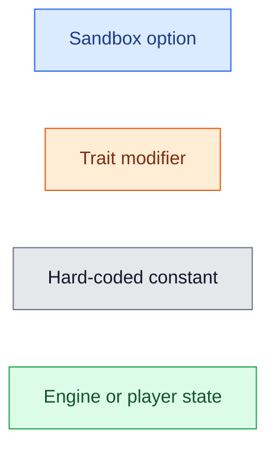
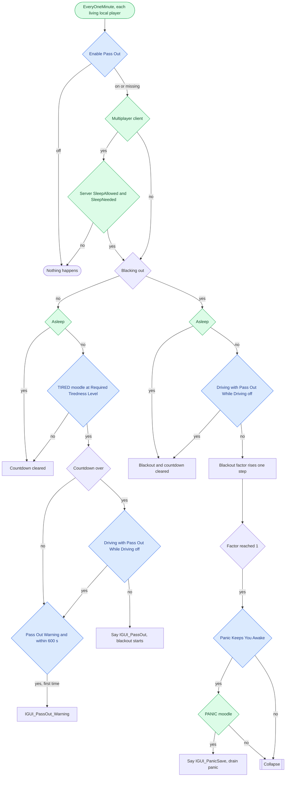
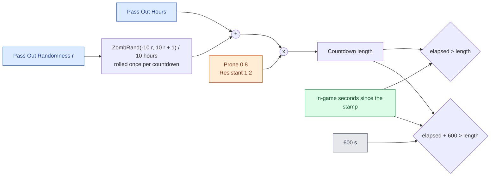
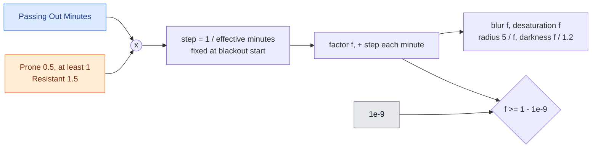
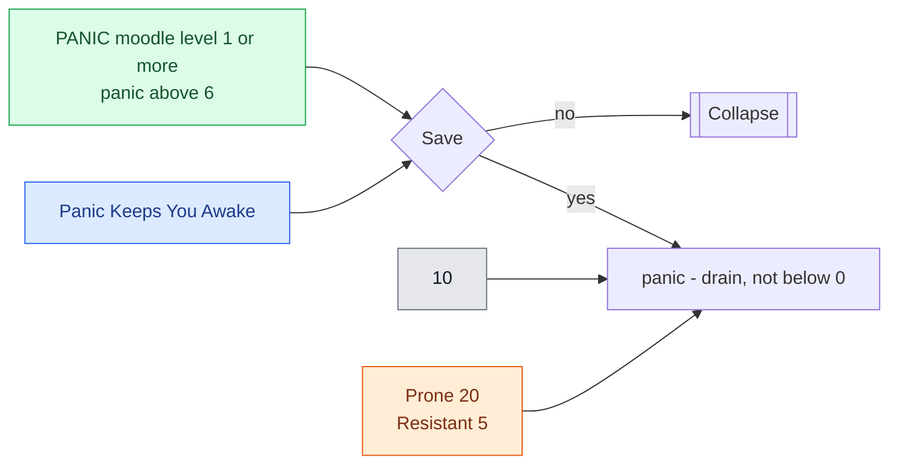
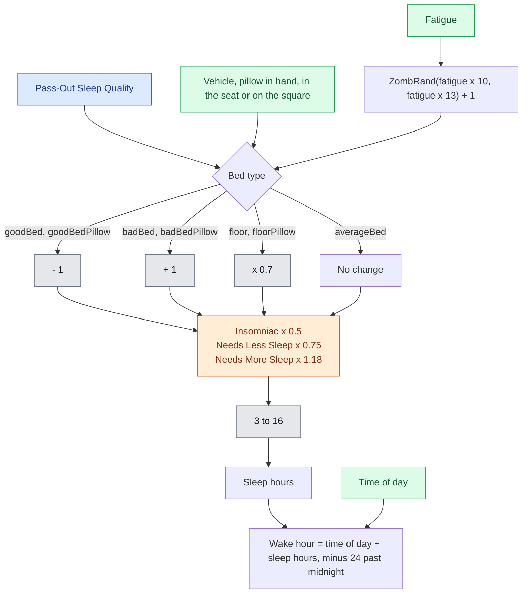
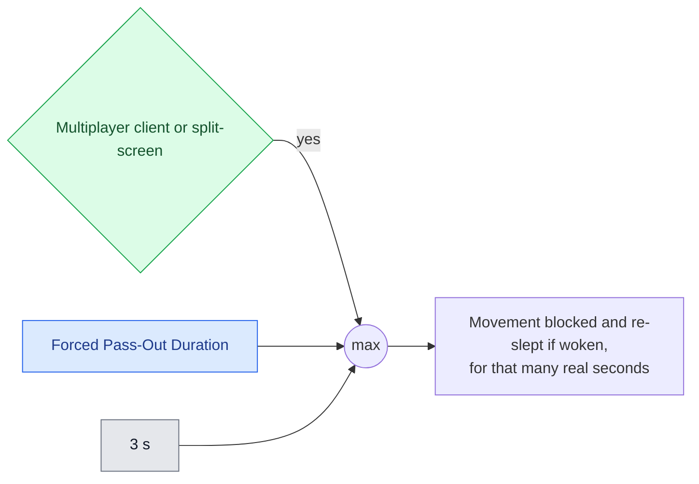

# Pass Out behaviour on Build 42

This is the behaviour of [Pass_Out.lua](../42/media/lua/client/Pass_Out.lua), the Build 42 client code. [pass_out_spec.lua](pass_out_spec.lua) tests each rule against the real file with [mocks.lua](mocks.lua) standing in for the game. A local player who stays at the Required Tiredness Level for Pass Out Hours blacks out over Passing Out Minutes and is then put to sleep where they stand. Panic can delay the collapse, and traits and sandbox options scale every step. Line links point into `Pass_Out.lua` unless they name another file. Build 41 (`media/`) is not covered.

The minute handler reads `SandboxVars.PassOut` again on each in-game minute ([L683](../42/media/lua/client/Pass_Out.lua#L683)). Changing an option in the debug console therefore applies from the next minute. The countdown start, the randomness roll and the blackout step size are stored in the player's ModData when they are first computed and are not recomputed.

## Legend

Diagram nodes are colored by where a value comes from. A condition that compares player state with an option is colored as the option. Uncolored nodes are the mod's own steps and state.

## Inputs

### Sandbox options

Defined in [sandbox-options.txt](../42/media/sandbox-options.txt). The fallback applies when the key is missing from `SandboxVars.PassOut`, for example in a save from an older version of the mod.

| Option | Key | Type and range | Default | Fallback when missing | Used in |
|--------|-----|----------------|---------|-----------------------|---------|
| Enable Pass Out | `enableMod` | boolean | true | true ([L37](../42/media/lua/client/Pass_Out.lua#L37)) | Lifecycle, character creation |
| Pass Out Hours | `passOutHours` | integer 0 to 72 | 6 | 6 | Countdown |
| Pass Out Randomness | `passOutRandomness` | double 0.0 to 1.0 | 0.2 | 0.2 | Countdown |
| Required Tiredness Level | `tiredLevel` | integer 2 to 4 | 4 | 4 | Countdown |
| Passing Out Minutes | `passingOutTime` | integer 1 to 20 | 5 | 5 | Blackout |
| Pass Out Warning | `warnPassOut` | boolean | true | off | Countdown |
| Panic Keeps You Awake | `panicKeepsAwake` | boolean | true | true ([L593](../42/media/lua/client/Pass_Out.lua#L593)) | Panic save |
| Forced Pass-Out Duration (seconds) | `forcedSleepSeconds` | integer 0 to 600 | 30 | 0, then the 3 s minimum | Hold |
| Pass-Out Sleep Quality | `passOutSleepQuality` | enum 1 to 4 | 1 | as 1 | Sleep length |
| Collapse Animation | `collapsePose` | boolean | true | true ([L303](../42/media/lua/client/Pass_Out.lua#L303)) | Collapse pose, remote sleepers |
| Pass Out While Driving | `passOutWhileDriving` | boolean | true | on (only `false` blocks, [L390](../42/media/lua/client/Pass_Out.lua#L390)) | Countdown, blackout |
| Honk When Passing Out at the Wheel | `hornWhilePassedOut` | boolean | true | on (only `false` silences, [L489](../42/media/lua/client/Pass_Out.lua#L489)) | Collapse |

### Traits

The mod's traits are registered by [registries.lua](../42/media/registries.lua) and defined in [PassOut_traits.txt](../42/media/scripts/PassOut_traits.txt). They are mutually exclusive. The vanilla sleep traits only change the sleep length.

| Trait | ID | Cost | Countdown | Blackout minutes | Panic drained per save | Sleep hours |
|-------|----|------|-----------|------------------|------------------------|-------------|
| Prone to Passing Out | `passout:pronetopassing` | -4 | x 0.8 ([L638](../42/media/lua/client/Pass_Out.lua#L638)) | x 0.5, at least 1 ([L654](../42/media/lua/client/Pass_Out.lua#L654)) | 20 | No change |
| Resistant to Passing Out | `passout:resistanttopassing` | 4 | x 1.2 ([L640](../42/media/lua/client/Pass_Out.lua#L640)) | x 1.5 ([L656](../42/media/lua/client/Pass_Out.lua#L656)) | 5 | No change |
| Neither | | | x 1 | x 1 | 10 ([L597](../42/media/lua/client/Pass_Out.lua#L597)) | No change |
| Insomniac (vanilla) | `CharacterTrait.INSOMNIAC` | | No change | No change | No change | x 0.5 ([L455](../42/media/lua/client/Pass_Out.lua#L455)) |
| Needs Less Sleep (vanilla) | `CharacterTrait.NEEDS_LESS_SLEEP` | | No change | No change | No change | x 0.75 |
| Needs More Sleep (vanilla) | `CharacterTrait.NEEDS_MORE_SLEEP` | | No change | No change | No change | x 1.18 |

### Engine values

| Value | Source | Behaviour |
|-------|--------|-----------|
| TIRED moodle level | Fatigue, `Moodle.java:129-180` and `MoodleStat.java:12-14` in the decompiled Build 42 code | The number of thresholds 0.6, 0.7, 0.8, 0.9 the fatigue is strictly above. Level 4 needs fatigue above 0.9. |
| PANIC moodle level | Panic, same classes | Thresholds 6, 30, 65, 80. Level 1 or more needs panic above 6. |
| `ZombRand(min, max)` | `LuaManager.java:6091`, `RandAbstract.java:33-50` | Truncates both bounds toward zero, then returns an integer in `[min, max)`. Returns `min` when they are equal. |
| `getGametimeTimestamp()` | `LuaManager.java:7736` | In-game seconds. Drives the countdown. |
| `getTimestampMs()` | `LuaManager.java:7726` | Real milliseconds. Drives the hold. |
| `getBedQuality(player, nil)` | `media/lua/client/ISUI/ISWorldObjectContextMenu.lua:2951` in the game folder | In a vehicle `badBed`, otherwise `floor`. Either gets the `Pillow` suffix when a pillow is in a hand, in the vehicle seat or on the player's square. |

### Constants

| Constant | Value | Code |
|----------|-------|------|
| Warning lead | 600 in-game seconds | [L24](../42/media/lua/client/Pass_Out.lua#L24) |
| Shortest hold | 3 real seconds | [L29](../42/media/lua/client/Pass_Out.lua#L29) |
| Remote sleeper sweep | every 10 ticks | [L301](../42/media/lua/client/Pass_Out.lua#L301) |
| Panic drain without a trait | 10 | [L597](../42/media/lua/client/Pass_Out.lua#L597) |
| Bed adjustment to sleep hours | goodBed -1, badBed +1, floor x 0.7 | [L452](../42/media/lua/client/Pass_Out.lua#L452) |
| Sleep length | 3 to 16 hours | [L458](../42/media/lua/client/Pass_Out.lua#L458) |
| Blackout completion tolerance | 1e-9 | [L589](../42/media/lua/client/Pass_Out.lua#L589) |
| Game speed once everyone sleeps | 3 | [L509](../42/media/lua/client/Pass_Out.lua#L509) |

## Lifecycle

`EveryOneMinute` runs [passOutTick](../42/media/lua/client/Pass_Out.lua#L679) for every living local player: one in single-player and multiplayer, up to four in split-screen. Each player's state is kept in their own ModData, and the blackout effect is set per player number.

The ModData fields below are saved with the character and can be read in the debug console with `getPlayer():getModData()`.

| Field | Set | Cleared |
|-------|-----|---------|
| `poTiredTime` | First minute at the level: the in-game timestamp | Level lost, asleep, blackout start, collapse, cancel, death |
| `poRandomnessValue` | Same minute: the roll in hours | Same |
| `poWarned` | When the warning shows | Same |
| `poPhase` | `"passing"` at blackout start | Collapse, cancel, death |
| `poPassOutFactor` | 0 at blackout start, then + step each minute | Same |
| `poStepFactor` | 1 / effective Passing Out Minutes at blackout start | Same |
| `poCollapsePose` | Collapse on foot with Collapse Animation on | Waking |
| `poForcedWakeAtMs`, `poWakeHour` | Collapse where input can wake a sleeper | End of the hold |
| `poBlockedMovement` | Hold start | End of the hold |
| `poHonking` | Collapse at the wheel of a car with a horn, with Honk When Passing Out at the Wheel on | Waking, leaving the seat, death, flat battery |

### Gating

| Situation | Runs |
|-----------|------|
| Enable Pass Out off | No |
| Single-player (`isClient()` false) | Yes, server sleep options are ignored ([L47](../42/media/lua/client/Pass_Out.lua#L47)) |
| Multiplayer client, server SleepAllowed and SleepNeeded both on | Yes |
| Multiplayer client, either off | No |
| Dead player | No, skipped by [forEachLocalPlayer](../42/media/lua/client/Pass_Out.lua#L55) |

### Countdown

[watch](../42/media/lua/client/Pass_Out.lua#L619) stamps `poTiredTime` on the first minute the TIRED moodle is at or above Required Tiredness Level while the player is awake, and rolls the randomness once. The countdown length is recomputed every minute from the stamp, the roll and the current options and traits.

- The roll moves the blackout by up to r hours either way in 0.1 hour (6 minute) steps ([L629](../42/media/lua/client/Pass_Out.lua#L629)). The range is absolute: r = 1 gives 5 to 7 hours at the default 6. Because `ZombRand` truncates its bounds, an r between steps behaves like the step below it: 0.25 acts as 0.2.
- The trait factor applies after the roll: Prone with r = 1 and the lowest roll gives (6 - 1) x 0.8 = 4 hours.
- The blackout starts on the first whole minute strictly after the countdown length ([L643](../42/media/lua/client/Pass_Out.lua#L643)). With Pass Out Hours 0 that is the minute after the stamp.
- The warning shows once, on the first minute within 600 s of the end ([L660](../42/media/lua/client/Pass_Out.lua#L660)), which is 10 minutes before the blackout starts. It shares an `elseif` with the blackout start, so a countdown shorter than 10 minutes warns on the stamp minute and blacks out on the next.
- Falling below the level or being asleep clears the stamp, the roll and the warning flag. The next qualifying minute starts a new countdown with a new roll.
- With Pass Out While Driving off, the countdown keeps running while the player drives, but the blackout waits for the first minute they are not the driver. Passengers are not held.

Timeline with all defaults and a roll of 0, in minutes after the stamp:

| Minute | Event |
|--------|-------|
| 0 | Countdown starts, roll made |
| 351 | IGUI_PassOut_Warning |
| 361 | Say IGUI_PassOut, blackout factor 0 |
| 362 to 365 | Factor 0.2, 0.4, 0.6, 0.8 |
| 366 | Factor 1.0, collapse or panic save |

With the default randomness of 0.2 the blackout starts between minute 349 and 373.

### Blackout

[advancePassingOut](../42/media/lua/client/Pass_Out.lua#L558) raises the factor once per minute and drives the foraging search-mode post-process as the blackout effect. With Project Viewpoint's first-person view on, a darkening vignette is drawn in the UI layer instead ([L148](../42/media/lua/client/Pass_Out.lua#L148)); the tests do not cover it.

- The blackout lasts the effective minutes rounded up: Resistant with 5 minutes takes 8. The tolerance absorbs the rounding of the summed steps. Without it, 6, 7, 10, 13, 14, 15 and 19 minutes took one minute longer.
- Changing Passing Out Minutes mid-blackout has no effect because the step is stored in `poStepFactor`.
- A player who falls asleep another way, or who becomes the driver with Pass Out While Driving off, has the blackout and the countdown cleared and the effect switched off without a collapse.
- The effect is switched off on collapse, cancel and death: blur, desaturation and darkness to 0, radius to 50, search mode disabled and `OnOverrideSearchManager` fired with `false` ([clearState](../42/media/lua/client/Pass_Out.lua#L252)).

### Panic save

When the factor reaches 1 and Panic Keeps You Awake is on, a player with the PANIC moodle stays awake for that minute ([L594](../42/media/lua/client/Pass_Out.lua#L594)).

Each save says IGUI_PanicSave and is re-checked the next minute, so a panic of P above 6 gives `ceil((P - 6) / drain)` saves before the collapse, not counting panic the game adds or removes in between. At 25 panic that is 2 saves without a trait, 1 for Prone and 4 for Resistant.

### Collapse

[forceSleep](../42/media/lua/client/Pass_Out.lua#L423) is a copy of vanilla's `onSleepWalkToComplete` without the checks that refuse sleep (nearby zombies, panic, pain, the `ExerciseEnded` variable).

1. Ends any exercise (`ExerciseStarted` false, `ExerciseEnded` true) and clears the timed action queue.
2. With Collapse Animation on and outside a vehicle, sets `poCollapsePose` and fires `EventSitOnGround` if the player is idle and upright. Otherwise the per-frame update fires it once they are.
3. Picks the bed type and sleep length below, then calls `setBed(nil)`, `setBedType`, `setForceWakeUpTime(wake hour)`, `setAsleepTime(0)` and `setAsleep(true)`.
4. Starts the hold where input can wake a sleeper.
5. At the wheel, plays `VehicleGoToSleep` and, with Honk When Passing Out at the Wheel on, leans on the horn if the car has one and a charged battery. A multiplayer client sends `vehicle onHorn` instead of calling `onHornStart`.
6. On a multiplayer client, fades the screen, sends `player onVehicleSleep` when in a vehicle and stops, as vanilla does. `setPlayerFallAsleep` is not called.
7. Otherwise calls `setPlayerFallAsleep(player, sleep hours rounded)` and fades the screen. When `IsoPlayer.allPlayersAsleep()` is true, it sets game speed 3 and saves.

| Pass-Out Sleep Quality | Bed type |
|------------------------|----------|
| 1, Floor | `getBedQuality(player, nil)`: `floor` or `floorPillow` on foot, `badBed` or `badBedPillow` in a vehicle ([L446](../42/media/lua/client/Pass_Out.lua#L446)) |
| 2, Rough | `badBed` |
| 3, Average | `averageBed` |
| 4, Good | `goodBed` |

The formula matches vanilla's (`media/lua/client/ISUI/ISWorldObjectContextMenu.lua:1057-1090` in the game folder). The engine also uses the bed type for fatigue recovery during the sleep. Examples at fatigue 0.95 and 12:00 with the lowest roll:

| Case | Sleep hours | `setPlayerFallAsleep` | Wake hour |
|------|-------------|-----------------------|-----------|
| Floor | (9 + 1) x 0.7 = 7 | 7 | 19 |
| Floor, highest roll | (11 + 1) x 0.7 = 8.4 | 8 | 20.4 |
| Rough | 9 + 1 + 1 = 11 | 11 | 23 |
| Good | 9 + 1 - 1 = 9 | 9 | 21 |
| Floor, Insomniac | 7 x 0.5 = 3.5 | 4 | 15.5 |
| Floor at 22:00 | 7 | 7 | 5 |

### Hold

In solo single-player the game speeds through sleep and input does not wake the player. On a multiplayer client or in split-screen, a movement or aim key wakes a sleeper ([wakesOnInput](../42/media/lua/client/Pass_Out.lua#L70)), so the collapse starts a hold measured in real time.

### Waking

[onPlayerUpdate](../42/media/lua/client/Pass_Out.lua#L518) runs every frame for local players.

| State | Each frame |
|-------|------------|
| Hold running, player alive | Movement stays blocked. A woken player gets the stored wake hour back, is set asleep and the screen fades again. |
| Hold over or player dead | Hold fields cleared, movement released if the mod blocked it. |
| `poHonking` and the player is awake, dead, out of the driver's seat or the battery is flat | Horn released. |
| `poCollapsePose` and asleep | `EventSitOnGround` fired again if the player is idle and upright, for example after a hit reaction. |
| `poCollapsePose` and awake | Field cleared; a player still sitting stops the action queue and gets `forceGetUp`. |

## Other events

### Remote sleepers

On a multiplayer client with the mod and Collapse Animation on, [updateRemoteSleepers](../42/media/lua/client/Pass_Out.lua#L348) runs every 10th `OnTick`. It drops every sleeping, living, non-local player that is idle and upright into the sit-on-ground pose and stands them up once they wake. It sends no packets and only changes this client's copy of those players.

### Death

`OnPlayerDeath` clears the blackout state and switches the effect off ([L736](../42/media/lua/client/Pass_Out.lua#L736)), because the minute handler skips dead players.

### Character creation

The traits are only offered where passing out can happen, that is when Enable Pass Out is on and the gating above lets the mod run.

- [isTraitEnabled](../42/media/lua/client/Pass_Out.lua#L706) returns false for both Pass Out traits otherwise and passes every other trait to vanilla.
- [prerender](../42/media/lua/client/Pass_Out.lua#L715) notices when availability changes, removes selected Pass Out traits when they become unavailable and rebuilds the trait lists once per change. The options are only known after the lists are first built: a new game's sandbox screen sets them after this screen is shown, and a server sends them after its Lua reload.
